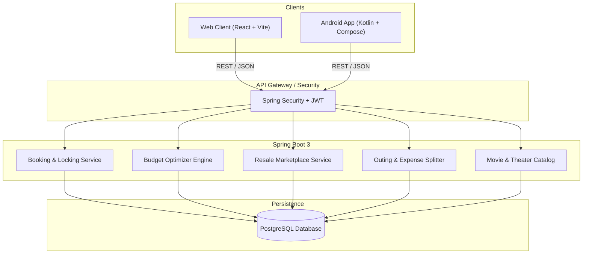

# 🎬 CineSync — Smart Movie Booking & Social Cinema Platform

[](https://spring.io/projects/spring-boot)
[](https://reactjs.org/)
[](https://developer.android.com/jetpack/compose)
[](https://www.postgresql.org/)
[](LICENSE)

**CineSync** is a full-stack, cross-platform movie booking and social cinema ecosystem. It bridges traditional cinema ticketing with modern, intelligent social utilities: **dynamic seat reservation**, **budget optimization algorithms**, **AI vibe search**, **fan-to-fan spare ticket resale**, and **group outing expense splitting**.

The repository is a unified monorepo containing:
1. **`backend/`**: High-performance RESTful API powered by Java 17, Spring Boot 3, Spring Security (JWT), and PostgreSQL.
2. **`frontend/`**: Modern, reactive web application built with React, Vite, Tailwind CSS, and Lucide Icons.
3. **`android/`**: Native Android mobile application written in Kotlin with Jetpack Compose, Material 3, and Retrofit2.

---

## 🌟 Key Features

### 1. 🎟️ Core Ticketing & Real-time Seat Locking
- Interactive visual seat layouts (Silver, Gold, Platinum).
- Race-condition protected seat reservations with temporary locking and expiry timeouts.
- Dynamic pricing based on screen formats (IMAX, 4DX, Standard) and seat categories.
- Digital wallet with instant booking passes and QR-code generation.

### 2. 🧠 Smart Budget Optimizer
- An algorithmic search engine for budget-conscious moviegoers.
- Users input their budget, group size, and preferred date: the optimizer evaluates show permutations across theaters and seat tiers to deliver the best value experiences without exceeding spending limits.

### 3. ✨ AI Vibe Search
- Natural language movie recommendations (e.g., *"thrilling mystery for late night"* or *"heartwarming family animated comedy"*).
- Maps user moods and prompts to catalog tags, genres, and active screenings.

### 4. 🔄 Fan-to-Fan Spare Ticket Marketplace
- Prevents unused tickets when plans change.
- Original bookers can list surplus tickets at face value.
- Automatic ownership transfer upon purchase, updating QR codes and preventing double-selling.

### 5. 👥 Group Outings & Expense Splitter
- Plan movie nights with friends within the app.
- Track ticket costs, popcorn/snacks, and cab expenses.
- Automatically calculates who owes whom with settlement tracking.

---

## 🏗️ System Architecture



---

## 📂 Repository Structure

```
Smart Movie Booking System/
├── backend/                       # Spring Boot 3 REST API
│   ├── src/main/java/com/moviebooking/
│   │   ├── config/                # Security, JWT, CORS, Web Config
│   │   ├── controller/            # REST Endpoints
│   │   ├── entity/                # JPA Database Entities
│   │   ├── repository/            # Spring Data JPA Repositories
│   │   ├── service/               # Core Business Logic & Algorithms
│   │   └── dto/                   # Data Transfer Objects
│   └── pom.xml
│
├── frontend/                      # React Web Application
│   ├── src/
│   │   ├── components/            # Modals, Navbar, Seat Grid, etc.
│   │   ├── context/               # Auth & Global State Context
│   │   ├── services/api.js        # Axios / Fetch HTTP Client
│   │   └── App.jsx
│   ├── package.json
│   └── vite.config.js
│
├── android/                       # Native Android Application (Kotlin)
│   ├── app/src/main/java/com/cinesync/app/
│   │   ├── data/                  # Retrofit API, Session, DTOs
│   │   └── ui/                    # Jetpack Compose Screens & Navigation
│   ├── build.gradle.kts
│   └── gradle/
│
└── KOTLIN_ANDROID_MOVIEGOER_SPEC.md # Full API Specification for Mobile
```

---

## 🚀 Getting Started

### Prerequisites
- **Java**: JDK 17 or higher
- **Node.js**: v18.0.0 or higher & npm
- **Database**: PostgreSQL 14 or higher
- **Android Studio**: Ladybug / Hedgehog or newer (with Android SDK 34)

---

### 1. Backend Setup (Spring Boot)

1. **Configure PostgreSQL:**
   Create a database named `moviebooking`:
   ```sql
   CREATE DATABASE moviebooking;
   ```

2. **Configure `application.properties`:**
   Ensure `backend/src/main/resources/application.properties` has your database credentials:
   ```properties
   spring.datasource.url=jdbc:postgresql://localhost:5432/moviebooking
   spring.datasource.username=postgres
   spring.datasource.password=your_password
   spring.jpa.hibernate.ddl-auto=update
   spring.jpa.show-sql=true

   # JWT Secret Key
   jwt.secret=your_super_secret_jwt_key_at_least_256_bits_long
   jwt.expiration=86400000
   ```

3. **Run the backend:**
   ```bash
   cd backend
   ./mvnw spring-boot:run
   ```
   The backend API will start on `http://localhost:8080`.

---

### 2. Web Frontend Setup (React + Vite)

1. **Install dependencies:**
   ```bash
   cd frontend
   npm install
   ```

2. **Launch dev server:**
   ```bash
   npm run dev
   ```
   The website will be available at `http://localhost:5173`.

3. **Production Build:**
   ```bash
   npm run build
   ```

---

### 3. Android Mobile App Setup (Kotlin + Jetpack Compose)

1. Open the `android/` directory in **Android Studio**.
2. Sync the project with Gradle files (`File > Sync Project with Gradle Files`).
3. **Configure API Base URL:**
   - In `android/app/src/main/java/com/cinesync/app/data/Net.kt`, adjust the base URL:
     - **Android Emulator:** `http://10.0.2.2:8080/api/`
     - **Physical Device:** `http://<YOUR_LOCAL_MACHINE_IP>:8080/api/`
4. Connect an Android device or launch an emulator and click **Run 'app'** (`Shift + F10`).

---

## 🔑 Default Roles & Access

| Role | Access Scope |
| :--- | :--- |
| **Moviegoer** | Browse movies, select seats, book tickets, use Budget Optimizer, AI search, Resale Marketplace, and Expense Splitter. |
| **Theatre Owner** | Manage theater halls, screens, schedule shows, and view theater earnings. |
| **Admin** | Platform analytics, approve theater registrations, manage global movie listings. |

---

## 🛠️ Tech Stack Breakdown

- **Backend:** Java 17, Spring Boot 3, Spring Data JPA, Spring Security, JJWT, Maven, PostgreSQL.
- **Frontend:** React 18, Vite, Tailwind CSS, Lucide React, Canvas Confetti.
- **Mobile:** Kotlin, Jetpack Compose, Material 3, Coroutines & Flow, Retrofit 2, OkHttp 3, Gson.

---

## 🤝 Contributing & Team
Pull requests and feature suggestions are welcome!
1. Fork the Project
2. Create your Feature Branch (`git checkout -b feature/AmazingFeature`)
3. Commit your Changes (`git commit -m 'Add some AmazingFeature'`)
4. Push to the Branch (`git push origin feature/AmazingFeature`)
5. Open a Pull Request

---

## 📄 License
This project is licensed under the MIT License — see the [LICENSE](LICENSE) file for details.
